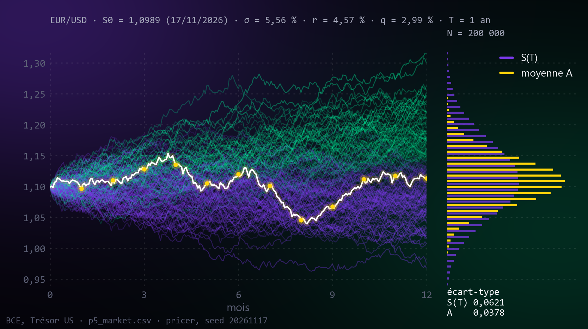
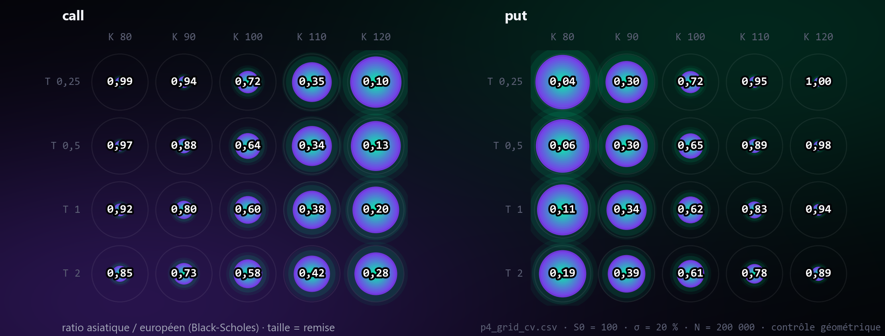
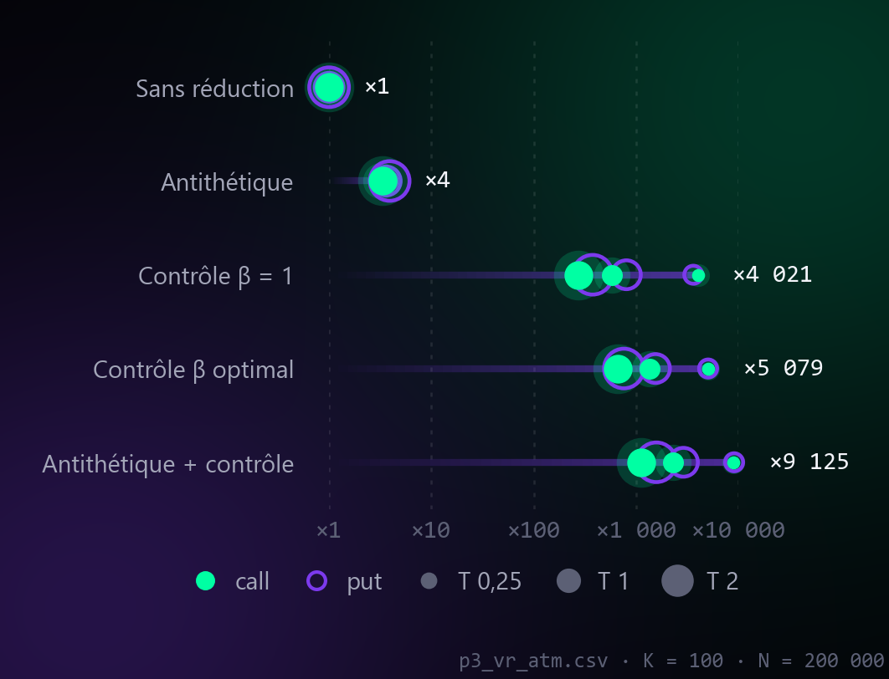
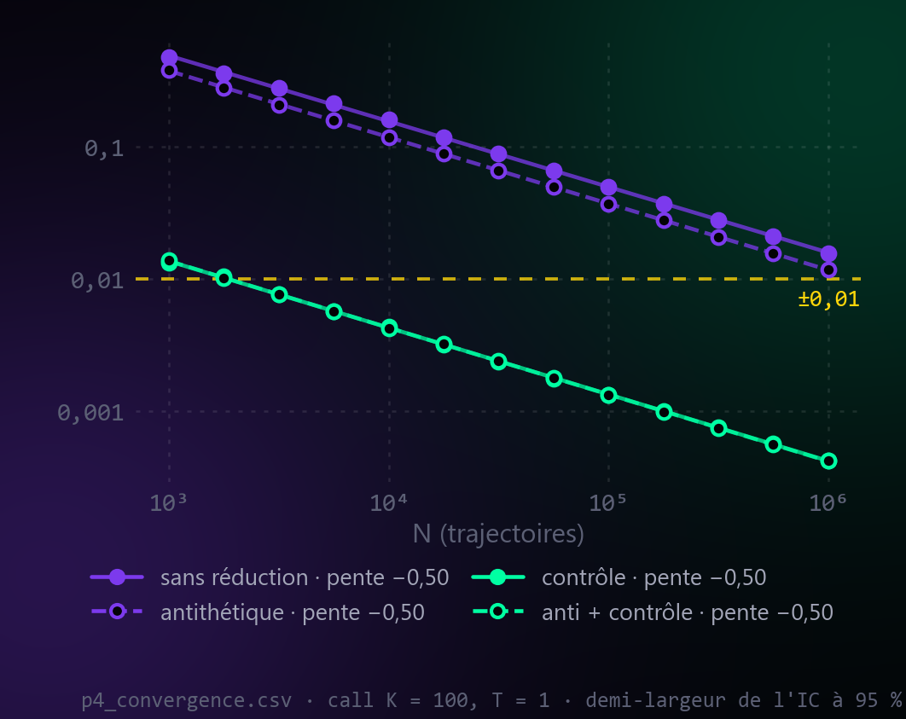
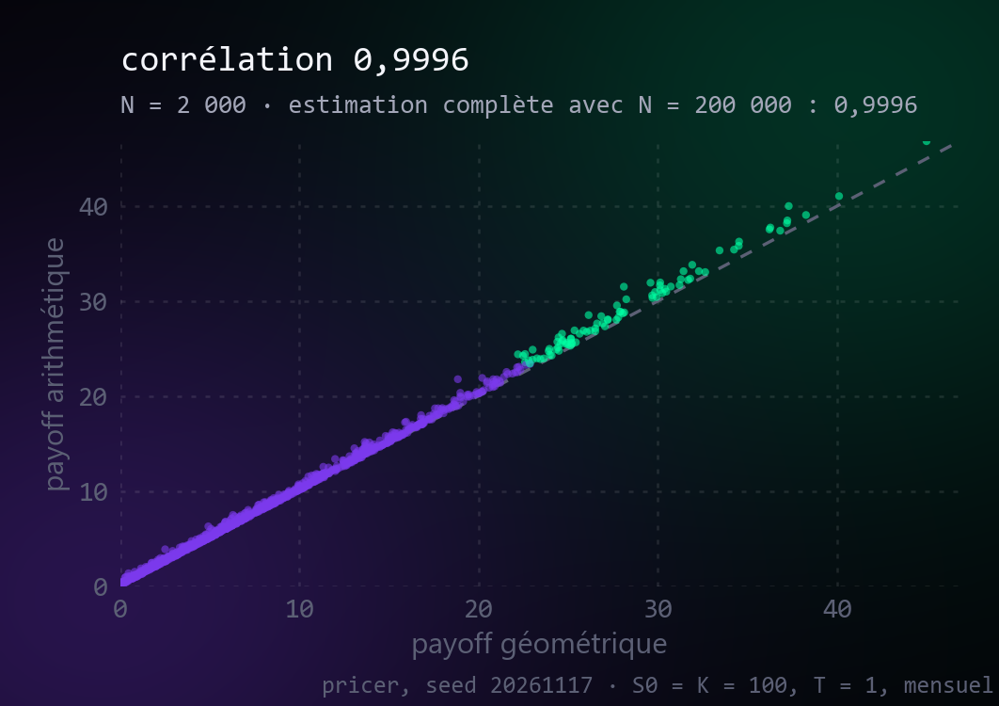
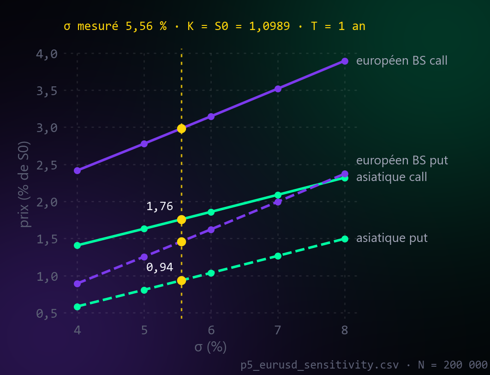
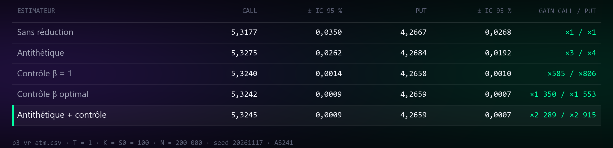
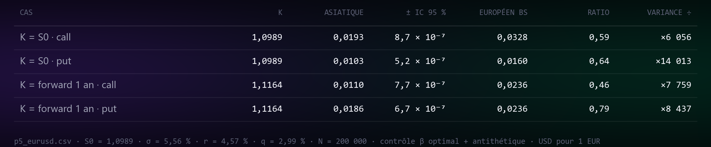

# Dossier du groupe : l'option asiatique pricée par Monte-Carlo

Projet Pricing Monte-Carlo, ING4 Finance, ECE Paris (A. W. Sanoussi Mani). Énoncé 2. Rendu le 22 novembre 2026.

**En PDF : [Dossier_Groupe_Pricing_Asiatique.pdf](pdf/Dossier_Groupe_Pricing_Asiatique.pdf)** (sommaire cliquable, une étape par page, figures intégrées, glossaire).

**Grille de conformité au sujet : [CONFORMITE.md](CONFORMITE.md).** Exigence par exigence : ce que le
sujet demande (cité mot pour mot), ce qui est fait et sa preuve, ce qu'on a fait en plus, ce qui reste
à faire. Comme l'oral, elle ne cite pas nos étapes de travail : on peut la montrer au professeur.

Ce dossier explique ce qu'on a fait, dans l'ordre, et ce que ça a donné. Il suffit de le lire pour
pouvoir en parler. C'est un document interne au groupe : il cite nos étapes de travail (P1 à P6) et
dit qui a pris chaque décision. Le rapport PDF et le texte de l'oral (`docs/ORAL.md`) sont écrits
pour le professeur et n'en parlent pas.

Tous les résultats chiffrés de ce fichier (prix, écarts-types, ratios, gains) sont recopiés par un
script depuis les fichiers de résultats (`results/*.csv`). Personne ne les a tapés. Les seuls nombres
écrits à la main sont des comptes de travail (nombre de tests, de mutations, durées approximatives),
tirés des rapports d'étape. Le fichier lui-même est produit par `scripts/p6_build.py` à partir de
`docs/templates/DOSSIER_GROUPE.md` : pour le corriger, on modifie le gabarit, pas ce fichier.

Sommaire : [1. En une page](#1-en-une-page) · [2. Étape par étape](#2-ce-quon-a-fait-étape-par-étape) ·
[3. Coquilles du cours](#3-les-6-coquilles-du-cours) · [4. Résultats](#4-les-résultats) ·
[5. Limites](#5-limites-et-choix-assumés) · [6. Relancer](#6-relancer-le-projet) ·
[7. Carte du dépôt](#7-carte-du-dépôt) · [8. Glossaire](#8-glossaire)

---

## 1. En une page

**Le sujet (énoncé 2).** Un actif suit le modèle de Black-Scholes : dS/S = (r − q) dt + σ dW, où r est
le taux sans risque, q le taux de dividende et σ la volatilité. Il faut :

1. pricer un call et un put asiatiques (le gain dépend de la moyenne arithmétique du cours, pas du
   cours final) par Monte-Carlo, c'est-à-dire en simulant beaucoup de trajectoires et en faisant la
   moyenne des gains ;
2. les comparer aux options européennes de mêmes caractéristiques, pour plusieurs strikes et
   maturités ;
3. réduire la variance du calcul avec une variable de contrôle : l'option sur moyenne géométrique ;
4. analyser le gain de temps et de précision.

Contrainte forte du cours : les nombres aléatoires doivent être fabriqués par nous, avec les méthodes
du cours. `numpy.random`, `random` et SciPy sont interdits dans le code du pricer (un test le vérifie).

**Ce qu'on rend.**

- Le code Python : une fonction `price_asian(S0, K, sigma, r, T, q, obs, ...)` dans `src/pricer/`,
  avec ses tests.
- Un classeur Excel de résultats : `results/pricing_asian_resultats.xlsx`.
- Un rapport PDF de 2 pages (plus la page de garde) : `rapport/Rapport_Pricing_Asiatique.pdf`.
- Le texte de la soutenance : `docs/ORAL.md`.

**Les 5 résultats qui comptent.**

1. **Notre aléa et notre pricer sont justes.** Les 5 méthodes de génération de normales passent le
   test de Kolmogorov-Smirnov (plus petite p-value : 0,60). Sur les 40 cas de la grille,
   notre prix Monte-Carlo de l'option européenne retombe sur la formule de Black-Scholes : la formule
   est dans l'intervalle de confiance 40 fois sur 40, et l'écart le plus grand vaut
   1,26 écart-type.
2. **L'asiatique coûte moins cher que l'européenne.** À la monnaie (K = S0 = 100), à 1 an, le call
   asiatique vaut 5,3242 contre 8,8273 pour l'européen : 0,60
   fois le prix, soit 40 % de moins. L'écart grandit avec la maturité (ratio
   0,72 à 3 mois, 0,58 à 2 ans) et surtout hors de la monnaie
   (ratio 0,20 pour le call K = 120 à 1 an).
3. **La variable de contrôle géométrique divise la variance par plus de mille.** Pour le call à 1 an,
   la variance est divisée par 1 384 : l'écart-type passe de 0,0178
   à 0,0005 avec les mêmes 200 000 trajectoires. Selon la maturité, le facteur va de
   667 à 5 359.
4. **Le gain de temps est du même ordre.** Pour connaître le prix à ±0,01 près, il faut
   2 447 439 trajectoires sans réduction de variance et 1 748 avec le contrôle,
   soit environ 1 400 fois moins. En comptant le temps de calcul, le gain d'efficacité
   est d'environ ×1 400 pour le contrôle seul et ×2 400
   quand on ajoute les variables antithétiques.
5. **Sur un cas réel, ça donne un prix utilisable.** Pour un exportateur français qui encaisse des
   dollars chaque mois pendant un an, le call asiatique sur EUR/USD à la monnaie vaut
   0,0193 USD par euro, soit 1,76 % du cours, contre 2,98 %
   pour le call européen. Pour 12 000 000 USD encaissés sur l'année, la prime est d'environ
   191 979 EUR.

---

## 2. Ce qu'on a fait, étape par étape

**Comment on a travaillé.** Le projet est découpé en étapes, de P1 à P6. Chaque étape suit le même
circuit. Loup prépare une consigne écrite avec Cowork (l'assistant avec lequel il rédige les
consignes et relit les rapports). Claude Code exécute la consigne : il écrit d'abord les tests, puis
le code, fait un commit par sous-étape et rend un rapport qui finit par ses questions. Cowork vérifie
le rapport et répond aux questions. Loup valide en lançant l'étape suivante. Les consignes sont dans
`prompts/`, les décisions dans `CLAUDE.md`, section « Décisions ».

Trois règles n'ont jamais bougé :

- aucun chiffre inventé : tout nombre vient du code exécuté, avec son écart-type, son intervalle de
  confiance, le nombre de tirages N et la seed (le point de départ du générateur aléatoire) ;
- le cours fait foi pour les formules ; ce qui n'y est pas est marqué « hors cours » dans le code ;
- les tests d'abord, et chaque test est éprouvé par mutation : on casse volontairement le code
  (un signe, un facteur) et on vérifie qu'un test devient rouge.

L'actif théorique qui sert à toutes les validations : S0 = 100, σ = 0,20, r = 0,03,
q = 0,01, observations mensuelles. La seed de référence du projet est 20261117.

### P1 — Socle et génération de l'aléa

**Objectif.** Fabriquer nous-mêmes des nombres aléatoires de loi normale, avec les seules méthodes du
cours.

**Ce qui a été construit.**

- `src/pricer/rng.py` : le générateur congruentiel linéaire (LCG). Il produit une suite d'entiers par
  la récurrence x ← a·x mod m, puis des nombres uniformes u = x/m. Par défaut ce sont les constantes
  de Park-Miller du cours (a = 16 807, m = 2³¹ − 1). On peut sauvegarder son état et sauter
  directement à la n-ième valeur.
- `src/pricer/normals.py` : cinq façons de transformer les uniformes en normales. La transformée
  inverse (deux versions : AS241, très précise, et Hastings, celle du slide 24), Box-Muller, la
  méthode polaire de Marsaglia et l'acceptation-rejet.
- `tests/test_no_forbidden_rng.py` : le garde-fou qui refuse `numpy.random`, `random` et SciPy dans
  `src/`.
- `scripts/p1_diagnostics.py` : mesure chaque méthode sur 1 000 000 normales et écrit
  `results/p1_rng_diagnostics.csv`.

**Comment on l'a vérifié.** 109 tests. Les 7 couples (m, a) de la figure 2 du cours sont reproduits au
bit près, les exemples du slide 7 aussi. Les deux méthodes à rejet sont comparées à la boucle écrite
comme dans le cours. 11 mutations ont été essayées, toutes détectées. Deux d'entre elles sont les
formules telles qu'elles sont imprimées dans les slides 23 et 24 : elles ne marchent pas, ce sont des
coquilles (section 3).

**Résultat chiffré** (1 000 000 normales par méthode, seed 20261117, temps médian de 5 runs) :

| Méthode | Temps (s) | Uniformes consommées par normale | Variance mesurée | p-value du test KS |
|---|---|---|---|---|
| Transformée inverse AS241 | 0,256 | 1,00 | 1,0012 | 0,65 |
| Transformée inverse Hastings | 0,092 | 1,00 | 1,0013 | 0,89 |
| Box-Muller | 0,037 | 1,00 | 0,9996 | 0,80 |
| Polaire (Marsaglia) | 0,059 | 1,27 | 0,9982 | 0,60 |
| Acceptation-rejet | 0,117 | 3,95 | 0,9982 | 0,68 |

Le test KS compare l'échantillon à la vraie loi normale : une p-value loin de zéro veut dire qu'on ne
voit pas de différence. Box-Muller est la plus rapide. L'acceptation-rejet jette des candidats : elle
consomme 3,95 uniformes par normale, pour un taux d'acceptation mesuré de
0,7601 (théorie : 0,7602). L'inverse AS241 est exacte à
3,6 × 10⁻¹⁵ près ; celle de Hastings à 4,4 × 10⁻⁴ près, ce qui correspond à la précision
annoncée au slide 24.

**Décisions.**

- Méthode par défaut du pricer : la transformée inverse AS241 (tranché par Cowork, validé par Loup).
  C'est la méthode phare du cours, elle consomme une uniforme par normale et elle est monotone, donc
  la variable antithétique du cours (U remplacé par 1 − U) s'applique exactement. Les autres méthodes
  restent disponibles par un paramètre.
- Seed de référence : 20261117, la date du jour (Cowork, validé par Loup).
- SciPy est permis dans `tests/` et `scripts/` pour servir de référence, jamais dans `src/` (Cowork).
- Hastings : on garde t = √(−2 ln p), la forme d'Abramowitz-Stegun 26.2.23 (Cowork).
- Acceptation-rejet : on garde la version lisible, et son coût est cité tel quel (Cowork).

### P2 — Trajectoires et pricer

**Objectif.** Simuler le cours de l'actif, pricer l'option asiatique, et prouver que le simulateur est
juste en retrouvant le prix connu de l'option européenne.

**Ce qui a été construit.**

- `src/pricer/paths.py` : les trajectoires. Le mouvement brownien géométrique se simule sans erreur
  de discrétisation, d'une date d'observation à la suivante :
  S(t + Δt) = S(t)·exp((r − q − σ²/2)Δt + σ√Δt·Z), avec Z une normale. Un seul flux de nombres
  aléatoires sert à tout le calcul.
- `src/pricer/black_scholes.py` : la formule fermée de Black-Scholes avec dividende, écrite avec
  `math.erfc` pour ne pas dépendre de SciPy.
- `src/pricer/asian.py` : `price_asian` (l'asiatique) et `price_european_mc` (l'européenne par
  Monte-Carlo). Les deux rendent un objet `MCResult` : prix, écart-type, intervalle de confiance à
  95 %, N, seed, méthode d'aléa, temps.
- `scripts/p2_grid.py` : la grille de 5 strikes (80 à 120), 4 maturités (3 mois à 2 ans), call et
  put, soit 40 cas, écrite dans `results/p2_grid.csv`.

**Comment on l'a vérifié.** 219 tests au total. La vérification centrale : sur les 40 cas, la
formule de Black-Scholes tombe dans l'intervalle de confiance du prix Monte-Carlo 40
fois, et l'écart maximal vaut 1,26 écart-type. D'autres tests portent sur la moyenne et la
variance des trajectoires, la parité call-put, la limite σ → 0 et un exemple du livre de Hull.
17 mutations essayées (signe de q, actualisation oubliée, σ²/2 oublié, S0 compté par erreur dans la
moyenne…), toutes détectées.

**Résultat chiffré** (K = 100, N = 200 000, sans réduction de variance) :

| Maturité T | Call asiatique (écart-type) | Call européen, Black-Scholes | Ratio | Put asiatique (écart-type) | Put européen, Black-Scholes | Ratio |
|---|---|---|---|---|---|---|
| 0,25 | 3,0310 (0,0100) | 4,2216 | 0,7180 | 2,6874 (0,0087) | 3,7241 | 0,7216 |
| 0,5 | 3,9026 (0,0130) | 6,0901 | 0,6408 | 3,3374 (0,0107) | 5,1001 | 0,6544 |
| 1 | 5,3177 (0,0178) | 8,8273 | 0,6024 | 4,2667 (0,0137) | 6,8669 | 0,6213 |
| 2 | 7,4093 (0,0253) | 12,8363 | 0,5772 | 5,4557 (0,0174) | 8,9929 | 0,6067 |

À la monnaie, l'asiatique vaut nettement moins que l'européenne, et le ratio baisse quand la maturité
augmente. L'écart-type de l'asiatique est plus petit que celui de l'européenne dans les
40 cas. Ces prix sont ceux de la première version, sans réduction de variance ; la
grille définitive (avec contrôle) est en P4.

**Décisions.**

- Actif réel : EUR/USD, à traiter après la validation sur l'actif théorique (Loup, 17/11).
- Nombre d'observations : fréquence × maturité, arrondi au plus proche (demi vers le haut), au moins 1
  (Cowork).
- Actif théorique : les paramètres ci-dessus (Cowork). Sa dérive logarithmique r − q − σ²/2 est
  nulle, ce qui cachait une erreur de signe à un test : les tests de signe utilisent donc un autre jeu
  de paramètres (relevé en P3).
- Les rapports d'étape (`reports/`) ne sont pas versionnés : ce sont des notes de travail. Tout
  chiffre du rendu vient de `results/` (Cowork).

### P3 — Réduction de variance

**Objectif.** Obtenir la même précision avec beaucoup moins de trajectoires, grâce à la variable de
contrôle géométrique demandée par le sujet, puis aux variables antithétiques du cours.

**L'idée de la variable de contrôle.** La moyenne géométrique des cours ressemble beaucoup à la
moyenne arithmétique, et l'option sur moyenne géométrique a un prix exact, par formule fermée. Sur
chaque trajectoire, on calcule donc les deux gains : Y (arithmétique, celui qu'on cherche) et X
(géométrique, dont on connaît l'espérance E[X]). On estime le prix par la moyenne de
Y − β·(X − E[X]). L'erreur faite sur X, qu'on connaît, sert à corriger celle faite sur Y. Le
coefficient β optimal du cours (slide 50) vaut Cov(X, Y)/Var(X).

**Ce qui a été construit.**

- `src/pricer/geometric.py` : la formule fermée de l'asiatique géométrique, pour des dates
  d'observation quelconques.
- `price_asian(control="geometric", beta="optimal")` : le contrôle, avec trois façons de choisir β.
  « optimal » l'estime sur l'échantillon (défaut), un nombre le fixe (par exemple 1), « pilot »
  l'estime sur un petit échantillon à part.
- `antithetic=True` : les variables antithétiques. Chaque trajectoire tirée avec les normales Z est
  jumelée à celle tirée avec −Z ; on fait la moyenne des deux gains.
- `scripts/p3_vr_atm.py` : compare 5 estimateurs à la monnaie, dans `results/p3_vr_atm.csv`.

**Comment on l'a vérifié.** 421 tests au total. La formule fermée est comparée à la forme du slide 76
(égalité à 10⁻¹² près) et à une simulation. Si on contrôle l'option géométrique par elle-même, on
retrouve exactement son prix fermé avec un écart-type nul. Les prix sans réduction n'ont pas bougé
d'un bit après les ajouts. 54 mutations essayées, toutes détectées, dont trois qui ont obligé à
ajouter ou corriger un test.

**Résultat chiffré** (K = 100, T = 1, N = 200 000 ; « ratio de variance » : par combien la
variance est divisée à N égal ; « gain d'efficacité » : pareil en comptant le temps de calcul) :

| Estimateur | Call | Écart-type | Ratio de variance | Gain d'efficacité (ordre de grandeur) | Put | Écart-type |
|---|---|---|---|---|---|---|
| Sans réduction | 5,3177 | 0,0178 | 1 | ×1 | 4,2667 | 0,0137 |
| Antithétique | 5,3275 | 0,0134 | 1,78 | ×3,3 | 4,2684 | 0,0098 |
| Contrôle, β = 1 | 5,3240 | 0,0007 | 630 | ×640 | 4,2658 | 0,0005 |
| Contrôle, β optimal | 5,3242 | 0,0005 | 1 384 | ×1 400 | 4,2659 | 0,0004 |
| Antithétique + contrôle | 5,3245 | 0,0005 | 1 398 | ×2 400 | 4,2659 | 0,0003 |

Ce qu'il faut en retenir :

- Les gains arithmétique et géométrique sont corrélés à 0,9996 (call, 1 an). C'est
  cette corrélation qui fait tout : la variance est divisée par 1/(1 − ρ²), soit
  1 384.
- Le β optimal mesuré va de 0,9649 à 1,0482 selon le cas. Le fixer à 1 marche, mais
  moins bien : le ratio de variance est 1,4 à 2,4 fois plus petit.
- L'antithétique seul divise la variance par 1,75 à 1,98.
- **La surprise de cette étape.** On attendait que « antithétique + contrôle » batte chacune des deux
  méthodes. C'est faux en variance : à nombre de trajectoires égal, la combinaison fait à peu près
  jeu égal avec le contrôle seul à la monnaie (1 398 contre
  1 384 ici), et elle fait moins bien pour une option dans la monnaie (deux cas
  sont testés dans `tests/test_antithetic.py`). La raison : une fois le contrôle appliqué, ce qui
  reste du gain est presque le même pour Z et pour −Z, alors que l'antithétique a besoin de deux
  moitiés qui se compensent. La combinaison reste la plus efficace parce qu'elle tire deux fois moins
  de normales : c'est un gain de temps, pas un gain de variance.

**Décisions.**

- La combinaison est présentée telle qu'elle est mesurée : un gain d'efficacité, sans promesse sur la
  variance. P4 compare à nombre de trajectoires égal et à temps égal (Cowork, validé par Loup).
- β « optimal » du slide 50 reste le réglage par défaut et sert aux chiffres du rapport ; son biais
  éventuel est mesuré en P4 (Cowork, validé par Loup).
- Mode pilote : 10 000 trajectoires de pilote, comptées en plus (Cowork, validé par Loup).
- Les exercices des slides 77 et 78 seront refaits comme validation (Cowork, validé par Loup).

### P4 — Analyse : précision, temps, sensibilités

**Objectif.** Répondre à la question 4 du sujet (gain de temps et de précision) avec des mesures, et
vérifier nos méthodes sur les exercices du cours.

**Ce qui a été construit.**

- `scripts/p4_cours.py` : les tableaux des slides 77 (asiatique avec contrôle) et 78 (européenne avec
  antithétiques), avec des intervalles de confiance à 99 % comme le demande le slide.
- `scripts/p4_convergence.py` : la précision en fonction de N (de 1 000 à 1 000 000), le
  nombre de trajectoires nécessaire pour une marge donnée, et la comparaison à temps de calcul égal.
- `scripts/p4_sensibilites.py` : le biais de β, l'effet de la méthode d'aléa, l'effet de la fréquence
  d'observation, et la grille strikes × maturités refaite avec le contrôle.
- `src/pricer/greeks.py` et `scripts/p4_greeks.py` : les sensibilités du prix (Greeks) par
  différences finies.
- Le paramètre `confidence` du pricer : le niveau de l'intervalle de confiance. Le quantile est
  calculé par notre inverse AS241, ce qui donne 1,959964 à 95 % au lieu du 1,96 arrondi du cours.

**Comment on l'a vérifié.** 518 tests au total. Sur les exercices du cours, la valeur de référence est
dans notre intervalle de confiance à 99 % dans 56 cases sur 56. Les prix de
référence sont calculés sur 4 000 000 trajectoires, tirées dans une partie du flux aléatoire que
l'échantillon testé n'utilise pas.

**Résultats chiffrés** (call, K = 100, T = 1, sauf mention).

*Convergence.* La demi-largeur de l'intervalle de confiance décroît comme 1/√N. Sur un graphique en
échelles logarithmiques, cela donne une droite de pente −0,5. Pentes mesurées sur
13 valeurs de N :

| Estimateur | Pente mesurée (écart-type) | Demi-largeur à N = 1 000 000 |
|---|---|---|
| Sans réduction | −0,4963 (0,0022) | 0,0157 |
| Antithétique | −0,5020 (0,0013) | 0,0117 |
| Contrôle | −0,5035 (0,0018) | 0,0004 |
| Antithétique + contrôle | −0,5049 (0,0010) | 0,0004 |

La réduction de variance ne change pas la pente : elle décale la droite vers le bas.

*Combien de trajectoires pour une marge donnée ?* N = (z·σ̂/ε)², avec σ̂ l'écart-type du gain par
trajectoire, ε la marge voulue et z = 1,959964 à 95 % :

| Estimateur | σ̂ par trajectoire | N pour ±0,01 | N pour ±0,001 | Temps estimé pour ±0,001 |
|---|---|---|---|---|
| Sans réduction | 7,9819 | 2 447 439 | 244 743 887 | environ 410 s |
| Antithétique | 5,9831 | 1 375 160 | 137 515 966 | environ 130 s |
| Contrôle | 0,2133 | 1 748 | 174 770 | environ 0,31 s |
| Antithétique + contrôle | 0,2140 | 1 762 | 176 006 | environ 0,18 s |

*À temps égal.* Avec un budget de 8 secondes, la marge d'erreur est de 0,0075 sans
réduction et 0,0041 avec l'antithétique. Avec le contrôle elle tombe à
0,0002, et la combinaison fait encore 1,3 fois mieux que le
contrôle seul, parce qu'elle a le temps de simuler plus de trajectoires (environ
7 500 000 contre 4 300 000). Entre « sans réduction » et la combinaison, la marge est
divisée par environ 49.

*Biais de β.* Estimer β sur le même échantillon que le prix crée en théorie un petit biais. On l'a
cherché avec 2 000 répétitions de 1 000 trajectoires : la moyenne des prix est à
+1,00 écart-type de la référence pour β optimal, et à −1,45 pour le mode
pilote (qui est sans biais par construction). Aucun biais n'est détecté. Voir P5b pour l'histoire de
ce chiffre.

*Méthode d'aléa.* Les 5 méthodes donnent le même prix : au plus 1,07 écart-type de la
référence. Avec contrôle : 5,3242 (AS241), 5,3242 (Hastings),
5,3244 (Box-Muller), 5,3246 (polaire), 5,3240 (acceptation-rejet).
Le choix de la méthode joue sur le temps, pas sur le prix.

*Fréquence d'observation.* Plus on observe souvent, moins l'option vaut cher. Call à 1 an :
8,8273 avec une seule observation (c'est exactement l'européenne), 5,3242 en
mensuel, 5,0167 en journalier.

*Grille avec contrôle.* Les 40 cas de P2 sont recalculés avec le contrôle. Le ratio de variance
va de 106 à 8 233 : l'écart-type est divisé par 10 à
91. Le contrôle aide moins loin hors de la monnaie. Pour le call à 1 an à la monnaie,
l'écart-type passe de 0,0178 à 0,0005. Un seul ratio asiatique / européen dépasse
1 : le put K = 120 à 3 mois, 1,0009 (intervalle [1,0008 ;
1,0009]). C'est un put très dans la monnaie avec r > q : la moyenne est en
espérance sous le cours final, donc le put sur moyenne vaut un peu plus.

*Exercice du slide 77* (S0 = 50, K = 50, T = 0,25, σ = 20 %,
r = 3 %, 63 observations journalières, N = 100 000) : le call vaut
1,2564 avec contrôle, la référence est 1,2564, le Monte-Carlo simple donne
1,2591 (écart-type 0,0058). Le prix exact de l'option géométrique est
1,2337. Dans les 6 cas où l'option a de la valeur, la variance est
divisée par 5 842 à 6 339.

*Exercice du slide 78* (européenne, S0 = 100, σ = 30 %, r = 5 %,
q = 7 %) : la corrélation entre le gain d'une trajectoire et celui de sa jumelle
antithétique vaut −0,30 pour le call à la monnaie et −0,88 pour le
put K = 110. Plus elle est négative, plus l'antithétique aide : la variance est divisée par
1,40 dans le premier cas, par 7,99 dans le second.

*Greeks* (K = 100, T = 1). Sur l'européenne, nos différences finies retrouvent les formules
fermées : delta du call 0,5741 contre 0,5735. Pour l'asiatique : delta
0,5450 (call) et −0,4360 (put), gamma 0,0316, vega
23,7377, soit 61 % du vega européen. Utiliser les mêmes nombres aléatoires
pour le prix et le prix décalé est indispensable : sans cela, l'écart-type du delta européen passe
de 0,0013 à 0,0217.

**Incidents.** Un calcul a été arrêté par manque de mémoire (un autre programme lourd tournait sur la
machine). Il a été relancé en lisant les données par plus petits paquets, sans changer les résultats.
Une colonne d'un CSV contenait du texte parasite : corrigée, avec deux tests ajoutés. D'où un commit
de plus que prévu.

**Décisions** (Cowork, validées par Loup en lançant P5a).

- Slide 77 : on montre les deux colonnes, « exact (géométrique, formule fermée) » et « référence
  arithmétique » calculée sur 4 000 000 trajectoires.
- Slide 78 : « variance MC » désigne la variance de l'estimateur, comparable d'un N à l'autre.
- Slide 78 : on garde la seed 20261117, même si ses 50 000 premières normales ont une variance de
  1,0105, ce qui place les prix antithétiques entre +1,68 et
  +1,83 écart-type de la valeur exacte. Changer de seed pour mieux tomber serait de
  l'ajustement.
- Les temps seront remesurés une fois, machine au repos (fait en P5b).
- Les répétitions du biais de β seront prises bout à bout dans un flux aléatoire unique, pour qu'elles
  soient vraiment indépendantes (fait en P5a).

### P5a — Actif réel : EUR/USD

**Objectif.** Appliquer le pricer à un vrai marché, avec des données officielles et datées.

**Le cas choisi (Loup).** Un exportateur français encaisse des dollars chaque mois pendant un an. Ce
qui compte pour lui, c'est le taux de change moyen de l'année. Il se couvre avec un call asiatique sur
EUR/USD (il touche la différence quand la moyenne des cours mensuels de l'euro dépasse le cours fixé
au départ), à la monnaie, 12 observations mensuelles, T = 1 an. Pour le change, le modèle de Black-Scholes
s'appelle Garman-Kohlhagen : le taux euro joue le rôle du dividende q, le taux dollar celui de r.

**Ce qui a été construit.**

- `scripts/p5_fetch.py` et `data/raw/` : les relevés bruts, conservés tels que reçus, avec leur date,
  leur adresse et leur empreinte (`data/raw/MANIFEST.md`).
- `src/pricer/market.py` et `scripts/p5_market.py` : la calibration, écrite dans
  `results/p5_market.csv`.
- `scripts/p5_eurusd.py` : les prix (`results/p5_eurusd.csv`) et leur sensibilité à la volatilité
  (`results/p5_eurusd_sensitivity.csv`).
- Dans `src/pricer/rng.py` : le saut exact dans le flux aléatoire et la vérification qu'un flux ne
  repasse pas par son point de départ.

**Comment on l'a vérifié.** 557 tests au total. Les 4 sources officielles ont répondu, et chaque
fichier est enregistré avec son empreinte (sha256). La série de la BCE est recoupée avec une deuxième
source (Alpha Vantage) sur 252 jours communs : écart absolu moyen de 0,0022, et
la volatilité calculée est la même (5,56 % et 5,56 %). Le prix européen simulé
sur les mêmes trajectoires retombe sur la formule fermée (à +0,12 écart-type pour
le call à la monnaie).

**Résultat chiffré : la calibration.**

| Paramètre | Valeur | Source et convention |
|---|---|---|
| Cours S0 | 1,0989 USD pour 1 EUR | fixing de référence BCE du 17/11/2026 |
| Volatilité σ | 5,56 % | écart-type des rendements journaliers des 252 derniers fixings BCE (depuis le 21/11/2025), multiplié par √252 |
| Taux dollar r | 4,57 % | Trésor américain 1 an du 16/11/2026 (4,62 % publié), converti en taux continu : r = 2·ln(1 + y/2) |
| Taux euro q | 2,99 % | courbe BCE des États notés AAA, 1 an, du 16/11/2026, déjà publiée en taux continu |
| Forward 1 an | 1,1164 | S0·exp(r − q) |

**Résultat chiffré : les prix** (en USD pour 1 EUR de nominal, N = 200 000, contrôle géométrique et
antithétiques ; valeurs après la correction de r faite en P5b) :

| Cas | Strike K | Asiatique | Demi-largeur de l'IC à 95 % | Européen (formule) | Ratio | Variance divisée par |
|---|---|---|---|---|---|---|
| K = S0, call | 1,0989 | 0,0193 | 8,7 × 10⁻⁷ | 0,0328 | 0,59 | 6 056 |
| K = S0, put | 1,0989 | 0,0103 | 5,2 × 10⁻⁷ | 0,0160 | 0,64 | 14 013 |
| K = forward, call | 1,1164 | 0,0110 | 7,7 × 10⁻⁷ | 0,0236 | 0,46 | 7 759 |
| K = forward, put | 1,1164 | 0,0186 | 6,7 × 10⁻⁷ | 0,0236 | 0,79 | 8 437 |

Coût de la couverture, pour un nominal illustratif de 1 000 000 USD encaissés par mois pendant
12 mois : 191 979 EUR à K = S0 (1,76 % des dollars
encaissés), 107 208 EUR à K = forward (0,98 %).

À K = S0 le call vaut plus que le put, parce que r > q : le marché attend un euro plus haut dans un
an (le forward 1,1164 est au-dessus du cours 1,0989).

**Décisions.**

- Série de cours : le fixing de la BCE en série principale, Alpha Vantage en contrôle (Loup).
- Volatilité : historique sur 1 an pour le prix central, puis des prix pour σ de 4 % à
  8 % (Loup).
- Taux euro : q = y, sans conversion. La consigne demandait ln(1 + y), mais la BCE publie ce taux déjà
  en composition continue : le convertir une deuxième fois aurait été une erreur. Écart signalé par
  Claude Code, vérifié par Cowork dans le fichier brut, validé par Loup.
- Strike central : K = S0, le cours du jour, qui est le taux de budget de l'exportateur. La ligne
  K = forward reste dans les tableaux (Cowork).
- Affichage : prix arrondis à 10⁻⁴ ; les écarts-types plus petits que 10⁻⁴ sont écrits en notation
  scientifique (Cowork).

### P5b — Corrections, temps au repos, figures, classeur

**Objectif.** Corriger ce que P5a avait laissé ouvert, puis produire les figures et le classeur Excel.

**Ce qui a été fait.**

- *Taux dollar.* Les rendements du Trésor américain sont publiés en base semestrielle. La conversion
  correcte est r = 2·ln(1 + y/2), ce qui donne 0,0457 au lieu de 0,0452 avec ln(1 + y)
  (sources : la FAQ du Trésor et un document de travail de la Réserve fédérale, FEDS 2006-28, lus le
  17/11/2026). Les prix EUR/USD ont été recalculés ; ce sont ceux du tableau ci-dessus.
- *Biais de β.* En P5a, sur 500 répétitions, le mode pilote sortait à
  −2,51 écart-type de la référence, ce qui intriguait puisqu'il est sans biais en
  théorie. Refait sur 2 000 répétitions indépendantes : −1,45. Le premier chiffre
  était une fluctuation. Rien n'a été ajusté.
- *Temps.* Les temps de calcul ont été remesurés une fois, machine au repos. Les prix et les
  écarts-types sont identiques au bit près ; seuls les temps et les gains d'efficacité changent.
  Entre les deux mesures, un même gain d'efficacité varie de −15 % à +37 %. Par exemple
  le contrôle seul (call, 1 an) donne ×1 454 puis ×1 350. C'est
  pourquoi on cite ces gains à l'ordre de grandeur (« environ ×1 400 »).
- *Figures.* `src/pricer/plotstyle.py` (le style) et `scripts/p5_figures.py` produisent 6 figures et
  2 tableaux dans `results/figures/`, en PNG et en PDF.
- *Classeur.* `scripts/p5_excel.py` produit `results/pricing_asian_resultats.xlsx` : un onglet
  « Lisez-moi » (méthode, sources, seed), un onglet « Paramètres », un onglet par CSV, un onglet
  « Figures ». Les valeurs sont copiées des CSV, sans formule.

**Comment on l'a vérifié.** 592 tests au total. Chaque figure se régénère à l'identique, octet pour
octet. Aucun nombre n'est tapé dans le script des figures : les nombres affichés sont relus sur les
figures et comparés aux CSV. Le classeur est comparé cellule par cellule aux CSV.

**Décisions.**

- Maquette du rapport « nuit profonde », palette Plasma (Loup, 17/11 à 15:21 : « Plasma validé pour
  moi »). Palette gardée telle quelle : le rendu est un PDF lu à l'écran (Cowork).
- Polices : Segoe UI pour le texte et Consolas pour les chiffres, installées avec Windows. Pas
  d'installation de polices (Cowork).
- Pas de grain sur les figures : il aurait demandé un bruit aléatoire (Cowork).

### P6 — Dossier, oral, rapport

Ce dossier, le texte de l'oral et le rapport PDF. Les trois sont des gabarits remplis par
`scripts/p6_build.py` : aucun résultat n'y est tapé à la main, et un test vérifie que chaque nombre
décimal vient d'un champ. Décision de Loup (17/11 à 19:19) : le rapport et l'oral ne mentionnent pas
nos outils de travail et sont écrits à la première personne du pluriel.

Puis P6b : la grille de conformité `docs/CONFORMITE.md` (même mécanique de gabarit). Elle relit le
sujet phrase par phrase, donne un statut sans complaisance à chaque exigence et la preuve (test, CSV,
page du rapport), liste ce qu'on a fait en plus avec deux phrases prêtes pour l'oral, et ce qui reste
à faire. Un test vérifie que chaque citation se retrouve dans le texte du PDF du sujet, et que chaque
test, fonction et CSV cités existent.

---

## 3. Les 6 coquilles du cours

On les a trouvées en codant les formules telles qu'elles sont imprimées. Elles seront citées à
l'oral. Les numéros de slides sont ceux de `PricingMonteCarlo_2026.pdf`.

| N° | Slide | Ce qui est écrit | La bonne forme | Comment on l'a vu |
|---|---|---|---|---|
| 1 | 9, générateur mixte | première condition de période complète : « c = 0 » | c ≠ 0 | à la lecture ; un générateur mixte avec c ≠ 0 atteint bien la période complète dans nos tests ; sans effet sur le code |
| 2 | 23, méthode polaire de Marsaglia | « V = −2U − 1 » | V = 2U − 1 | codée telle quelle, la méthode n'accepte jamais aucun candidat : le programme s'arrête en erreur |
| 3 | 24, Hastings | dénominateur « d1 + d2 t² + d3 t³ » | 1 + d1 t + d2 t² + d3 t³ | codée telle quelle, trois tests deviennent rouges (précision, moments, test KS) |
| 4 | 24, Hastings | t lu « −log(min(U, 1 − U)) » | t = √(−2 ln p), forme d'Abramowitz-Stegun 26.2.23 | avec la bonne forme, l'erreur mesurée (4,4 × 10⁻⁴) correspond à la précision annoncée par le slide |
| 5 | 76, moyenne géométrique | « T = (1/n) Σ S(t_j) » | T̄ = (1/n) Σ t_j : c'est la moyenne des dates, pas des cours | en comparant le slide à notre formule fermée |
| 6 | 76, moyenne géométrique | σ̄² = σ²/(n²T̄)·Σ(2i − 1)·t_{n+1−j} : les indices i et j sont mélangés | lire i partout | avec un seul indice, la formule est égale à la nôtre à 10⁻¹² près (testé sur 12 cas) ; le slide est écrit sans dividende q |

Réserve : le PDF du cours est en images. On a lu les formules dans le texte extrait d'une version
« draft » du même cours ; les coquilles 4 à 6 n'ont pas été relues à l'œil sur le slide.

---

## 4. Les résultats

Les figures sont dans `results/figures/` (PNG et PDF). Elles sont produites par
`scripts/p5_figures.py` et ne se retouchent pas à la main.

### Figure 1 — La moyenne disperse moins que le cours final



- **Ce qu'on voit.** À gauche, 200 trajectoires simulées de l'EUR/USD sur 12 mois, calibrées sur le
  marché du 17/11/2026. Une trajectoire est tracée en blanc avec ses 12 relevés mensuels. À
  droite, deux histogrammes sur 200 000 trajectoires : le cours final S(T) et la moyenne A des
  12 relevés.
- **Ce que ça veut dire.** L'histogramme de la moyenne est plus resserré que celui du cours final. Une
  moyenne lisse les mouvements. C'est la raison pour laquelle l'option asiatique coûte moins cher :
  moins d'incertitude, moins de valeur.

### Figure 2 — Asiatique / européen, pour 5 strikes et 4 maturités



- **Ce qu'on voit.** Pour chaque strike K et chaque maturité T, le prix asiatique divisé par le prix
  européen. Plus le disque est gros, plus la remise est grande. Call à gauche, put à droite.
- **Ce que ça veut dire.** À la monnaie (K = 100), le ratio va de 0,72 à
  0,58 pour le call : la remise grandit avec la maturité. Dans la monnaie, les deux
  options se valent presque (0,92 pour le call K = 80 à 1 an). Hors de la monnaie,
  l'asiatique ne vaut plus qu'une fraction de l'européenne (0,20 pour le call
  K = 120) : il faut que la moyenne, et pas seulement le cours final, dépasse le strike.

### Figure 3 — Gain d'efficacité par méthode



- **Ce qu'on voit.** Pour chaque méthode, le gain d'efficacité (variance × temps de la méthode simple,
  divisé par celui de la méthode), en échelle logarithmique. Points pleins : call ; anneaux : put ;
  taille : maturité. Le nombre à droite est le plus grand gain de la ligne.
- **Ce que ça veut dire.** L'antithétique seul gagne un facteur 3,2 à
  3,9. Le contrôle géométrique gagne des milliers. Le gain est le plus fort aux
  maturités courtes, où les moyennes arithmétique et géométrique se ressemblent le plus. Ces gains
  dépendent du temps mesuré : la figure montre la mesure faite machine au repos, et l'ordre de
  grandeur est le bon chiffre à citer.

### Figure 4 — La marge d'erreur en fonction du nombre de trajectoires



- **Ce qu'on voit.** La demi-largeur de l'intervalle de confiance à 95 % en fonction de N, en échelles
  logarithmiques, pour 4 estimateurs. La ligne en pointillés est la marge ±0,01.
- **Ce que ça veut dire.** Les 4 droites sont parallèles, de pente −0,50 : l'erreur diminue
  comme 1/√N quelle que soit la méthode. Le contrôle décale la droite vers le bas. La marge de
  ±0,01 est atteinte vers N = 1 748 avec le contrôle ; sans lui il en faut
  2 447 439.

### Figure 5 — Pourquoi le contrôle marche



- **Ce qu'on voit.** Chaque point est une trajectoire : en abscisse le gain de l'option géométrique,
  en ordonnée celui de l'option arithmétique. 2 000 trajectoires.
- **Ce que ça veut dire.** Les points sont presque alignés : la corrélation vaut
  0,9996. Connaître le gain géométrique, c'est presque connaître le gain
  arithmétique. Comme le prix géométrique est connu exactement, on corrige l'essentiel de l'erreur.
  Les points sont au-dessus de la diagonale parce que la moyenne arithmétique est toujours supérieure
  ou égale à la moyenne géométrique.

### Figure 6 — Le cas EUR/USD selon la volatilité



- **Ce qu'on voit.** Le prix des options EUR/USD à la monnaie, en pourcentage du cours, quand la
  volatilité varie de 4 % à 8 %. Le trait vertical est la volatilité
  mesurée, 5,56 %.
- **Ce que ça veut dire.** Au niveau mesuré, le call asiatique coûte 1,76 % du cours et
  le put 0,94 %. Le prix dépend presque linéairement de la volatilité : de
  1,41 % à 2,32 % pour le call. Comme on ne connaît pas la
  volatilité future, cette fourchette est plus honnête qu'un prix unique.

### Tableau 1 — Cinq estimateurs à la monnaie



- **Ce qu'on voit.** Pour T = 1 an et K = 100 : le prix du call et du put avec chaque estimateur, la
  demi-largeur de l'intervalle de confiance, et le gain d'efficacité.
- **Ce que ça veut dire.** Les cinq estimateurs donnent le même prix, à leur marge d'erreur près. La
  marge passe de 0,0350 à 0,0009 pour le call. Les gains affichés
  sont ceux de la mesure au repos.

### Tableau 2 — Le cas EUR/USD



- **Ce qu'on voit.** Les 4 options EUR/USD : call et put, au strike K = S0 et au strike forward.
- **Ce que ça veut dire.** La marge d'erreur est de l'ordre de 10⁻⁷ : sur ce marché peu volatil, le
  contrôle divise la variance par 6 056 à 14 013. Au strike forward, le call
  et le put européens ont le même prix (0,0236), mais pas les asiatiques : la moyenne des
  cours attendus sur l'année est sous le forward à 1 an.

---

## 5. Limites et choix assumés

- **Volatilité historique.** On n'a pas de source gratuite de volatilité implicite (celle que le
  marché des options affiche). On prend la volatilité mesurée sur un an de cours et on donne les prix
  pour σ de 4 % à 8 %.
- **Black-Scholes pour le change.** Le modèle suppose une volatilité et des taux constants, sans
  sauts. Sur le change, la volatilité dépend en réalité du strike et de la maturité. Notre prix est
  celui du modèle du cours, pas une cotation de marché.
- **Dates d'observation.** Les 12 observations sont régulièrement espacées (une par douzième
  d'année), pas calées sur un calendrier de jours ouvrés.
- **Nominal illustratif.** Le million de dollars par mois de l'exportateur est un exemple. Le prix par
  euro, lui, ne dépend pas du nominal.
- **Biais de β.** Estimer β sur l'échantillon crée en théorie un biais en 1/N. À 1 000
  trajectoires et 2 000 répétitions on ne le détecte pas (+1,00 écart-type).
  Aux N que nous utilisons, il est plus petit encore.
- **Temps machine.** Les temps dépendent de la machine et de ce qui tourne dessus. Deux mesures du
  même calcul donnent des gains d'efficacité différents de −15 % à +37 %. Les ratios de
  variance, eux, sont exacts et reproductibles.
- **Une seule seed.** Tous les résultats partent de la seed 20261117. Un autre point de départ
  donnerait des prix légèrement différents, à l'intérieur des intervalles de confiance. L'exercice du
  slide 78 le montre : avec cette seed les prix antithétiques sont un peu hauts, et on l'a laissé tel
  quel.
- **Le générateur.** Le LCG de Park-Miller a une période d'environ deux milliards de valeurs. C'est
  assez pour nos calculs (le plus long en consomme 312 000 000), mais des seeds voisines donnent
  des suites qui se recouvrent. Pour des répétitions indépendantes, on découpe un seul flux bout à
  bout.
- **Lecture du cours.** Le PDF du cours est en images : les formules ont été lues dans le texte
  extrait d'une version « draft ».
- **Figures.** Les figures de travail (`results/figures/`) portent une ligne de source courte avec
  le nom du fichier CSV ; celles du mode rendu (`results/figures/rendu/`, rapport, oral, paquet)
  disent la source en clair, sans nom de fichier, et donnent les gains à l'ordre de grandeur.

---

## 6. Relancer le projet

Le projet a été fait avec Python 3.13.1 sous Windows. Les versions des paquets sont fixées dans
`requirements.txt` (NumPy 2.3.1, SciPy 1.16.0, pandas 2.3.1, matplotlib
3.10.3, openpyxl 3.1.5, pytest 8.4.1).

```powershell
# installation, une fois
python -m venv .venv
.venv\Scripts\python.exe -m pip install -r requirements.txt
$env:PYTHONIOENCODING = "utf-8"          # la console Windows ne sait pas afficher √ sans cela

# les tests
.venv\Scripts\python.exe -m pytest

# les calculs, dans l'ordre
.venv\Scripts\python.exe scripts\p1_diagnostics.py
.venv\Scripts\python.exe scripts\p2_grid.py
.venv\Scripts\python.exe scripts\p3_vr_atm.py
.venv\Scripts\python.exe scripts\p4_cours.py
.venv\Scripts\python.exe scripts\p4_convergence.py
.venv\Scripts\python.exe scripts\p4_sensibilites.py
.venv\Scripts\python.exe scripts\p4_greeks.py
.venv\Scripts\python.exe scripts\p5_market.py
.venv\Scripts\python.exe scripts\p5_eurusd.py

# les rendus
.venv\Scripts\python.exe scripts\p5_figures.py
.venv\Scripts\python.exe scripts\p5_excel.py
.venv\Scripts\python.exe scripts\p6_build.py --pdf
```

Durées relevées sur la machine de Loup pendant le projet (parfois chargée, donc indicatives) :

| Commande | Durée |
|---|---|
| `pytest` (tous les tests) | environ 1 min 10 s |
| `p1_diagnostics.py` | non relevée |
| `p2_grid.py` | environ 30 s |
| `p3_vr_atm.py` | environ 30 s |
| `p4_cours.py` | environ 6 min |
| `p4_convergence.py` | environ 5 min |
| `p4_sensibilites.py` | environ 3 min (2 min 30 s relevées avant le passage du biais de β à 2 000 répétitions) |
| `p4_greeks.py` | environ 30 s |
| `p5_market.py`, `p5_figures.py`, `p5_excel.py` | non relevées |
| `p5_eurusd.py` | environ 15 s |
| `p6_build.py` | quelques secondes |

À savoir avant de relancer :

- **Les prix ne changent pas** : même seed, mêmes prix, au bit près. **Les temps changent** à chaque
  mesure (`p3_vr_atm.py`, `p4_convergence.py`), donc les gains d'efficacité aussi. Après une relance,
  il faut refaire les figures, le classeur, puis `p6_build.py`, sinon les tests de régénération
  deviennent rouges.
- **Ne pas relancer `scripts/p5_fetch.py`** : il télécharge les données du jour. Les relevés du
  17/11/2026 sont versionnés dans `data/raw/` et tout le cas EUR/USD en dépend.
- `p6_build.py --pdf` a besoin de Chrome ou d'Edge installé. Sans `--pdf`, il n'écrit que les fichiers
  texte. `p6_build.py --list` affiche chaque champ utilisé, sa valeur et le CSV d'où il vient.
- Rien n'est jamais poussé sur GitHub par un script : c'est Loup qui pousse.

---

## 7. Carte du dépôt

| Dossier ou fichier | À quoi il sert |
|---|---|
| `CLAUDE.md` | les règles du projet, l'énoncé recopié, toutes les décisions datées, les coquilles du cours |
| `docs/2026-S1_ProjetPricing.pdf` | le sujet |
| `docs/DOSSIER_GROUPE.md` | ce dossier |
| `docs/ORAL.md` | le texte de la soutenance et les questions probables |
| `docs/CONFORMITE.md` | la grille de conformité au sujet : exigences, statuts, preuves, ajouts, reste à faire |
| `docs/pdf/` | les mêmes documents en PDF pour le groupe : ce dossier, les fiches de l'oral, la grille (`p6_build.py --pdf-groupe`) |
| `docs/templates/` | les gabarits du dossier, de l'oral et de la grille (c'est eux qu'on modifie) |
| `docs/maquettes/` | les maquettes graphiques, dont celle retenue par Loup |
| `rapport/` | le gabarit du rapport, le rapport en HTML et le PDF rendu |
| `src/pricer/rng.py` | le générateur congruentiel (LCG) |
| `src/pricer/normals.py` | les 5 méthodes pour fabriquer des normales |
| `src/pricer/paths.py` | les trajectoires du cours |
| `src/pricer/black_scholes.py` | la formule fermée de l'option européenne |
| `src/pricer/geometric.py` | la formule fermée de l'asiatique géométrique |
| `src/pricer/asian.py` | le pricer : `price_asian`, `price_european_mc`, `MCResult` |
| `src/pricer/greeks.py` | les sensibilités (delta, gamma, vega) |
| `src/pricer/market.py` | la lecture des données de marché et les conversions de taux |
| `src/pricer/plotstyle.py` | le style des figures |
| `scripts/p1_…` à `scripts/p5_…` | un script par calcul ; chacun écrit un ou plusieurs CSV dans `results/` |
| `scripts/p6_build.py` | remplit les gabarits et produit le PDF |
| `tests/` | les tests (pytest), un fichier par module ou par script |
| `data/raw/` | les relevés de marché bruts du 17/11/2026 et leur journal (`MANIFEST.md`) |
| `results/*.csv` | tous les résultats ; c'est la seule source des chiffres du rendu |
| `results/figures/` | les 6 figures et les 2 tableaux, en PNG et en PDF |
| `results/pricing_asian_resultats.xlsx` | le classeur Excel |
| `results/historique/` | deux anciennes mesures (première mesure des temps, biais sur 500 répétitions), gardées pour pouvoir citer l'écart entre deux mesures |
| `prompts/` | les consignes de chaque étape |
| `reports/` | les rapports d'étape ; non versionnés, ils ne sont que sur la machine de Loup |
| `requirements.txt` | les versions exactes des paquets Python |

---

## 8. Glossaire

**LCG** (générateur congruentiel linéaire) : la recette du cours pour fabriquer des nombres qui ont
l'air aléatoires. On part d'un entier, on le multiplie par une constante, on garde le reste de la
division par une autre constante, et on recommence.

**Seed** (graine) : l'entier de départ du générateur. Même seed, mêmes nombres, donc mêmes prix : c'est
ce qui rend nos résultats reproductibles.

**Transformée inverse** : pour obtenir une normale à partir d'un nombre uniforme U entre 0 et 1, on
calcule la valeur dont la probabilité cumulée vaut U. AS241 et Hastings sont deux formules
d'approximation de ce calcul.

**Box-Muller** : une formule qui transforme deux uniformes en deux normales, avec un logarithme, une
racine, un cosinus et un sinus. La méthode polaire de Marsaglia en est une variante sans cosinus ni
sinus.

**Acceptation-rejet** : on tire un candidat dans une loi simple, on le garde avec une certaine
probabilité, sinon on recommence. C'est juste, mais on jette des tirages.

**Mouvement brownien géométrique** : le modèle de Black-Scholes pour le cours d'un actif. Le rendement
sur un petit intervalle est une tendance plus un aléa normal, et le cours reste positif.

**Option asiatique** : une option dont le gain dépend de la moyenne des cours relevés à des dates
fixées, et non du cours final. Pour un call : max(moyenne − K, 0).

**Moyenne géométrique** : la racine n-ième du produit de n valeurs. Elle est toujours inférieure ou
égale à la moyenne arithmétique. Son intérêt ici : sous Black-Scholes, l'option sur moyenne
géométrique a un prix exact.

**Estimateur Monte-Carlo** : on simule N trajectoires, on calcule le gain actualisé sur chacune, et on
prend la moyenne. C'est une estimation du prix, avec une erreur qui diminue comme 1/√N.

**IC** (intervalle de confiance) : la fourchette autour du prix estimé qui contient le vrai prix avec
une probabilité donnée (95 % ici). Sa demi-largeur vaut z fois l'écart-type de l'estimateur.

**Variable de contrôle** : une quantité très corrélée à celle qu'on cherche et dont on connaît
l'espérance exacte. L'erreur qu'on observe sur elle sert à corriger l'estimation.

**β** (bêta) : le coefficient qui dose la correction de la variable de contrôle. Le β optimal vaut
Cov(X, Y)/Var(X).

**Antithétique** : on utilise chaque tirage Z deux fois, une fois tel quel et une fois changé de
signe. Les deux erreurs se compensent en partie.

**Efficacité** : variance de l'estimateur × temps de calcul. Plus c'est petit, mieux c'est. Le gain
d'efficacité d'une méthode est l'efficacité de la méthode simple divisée par la sienne.

**Garman-Kohlhagen** : le modèle de Black-Scholes appliqué à un taux de change. Le taux d'intérêt de
la devise qu'on achète (ici l'euro) joue le rôle du dividende.

**Forward** : le cours auquel on peut fixer aujourd'hui un échange futur. Ici F = S0·exp((r − q)·T).

**Greeks** : les sensibilités du prix. Delta : variation du prix quand le cours bouge. Gamma :
variation du delta. Vega : variation du prix quand la volatilité bouge.
