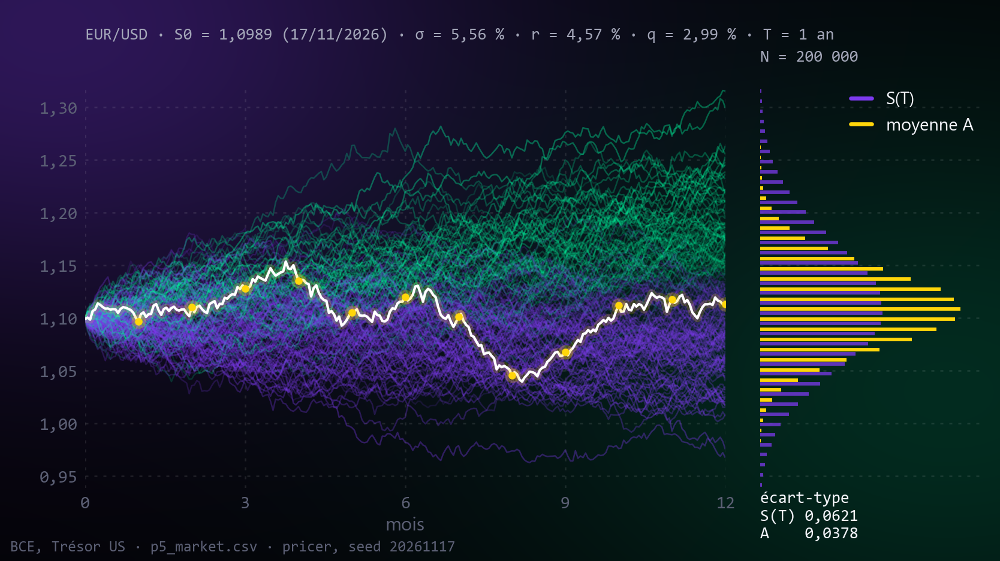
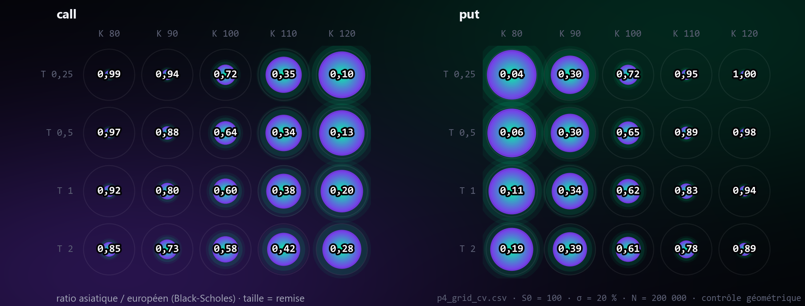
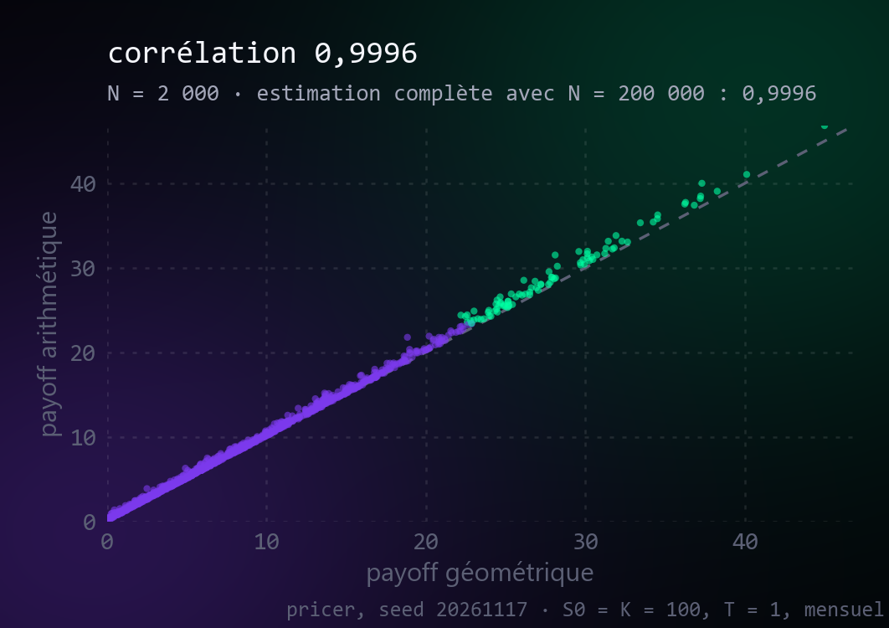
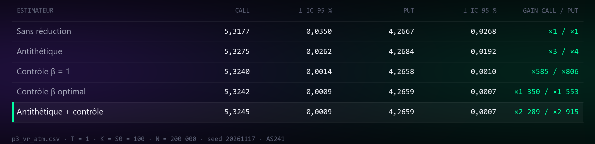
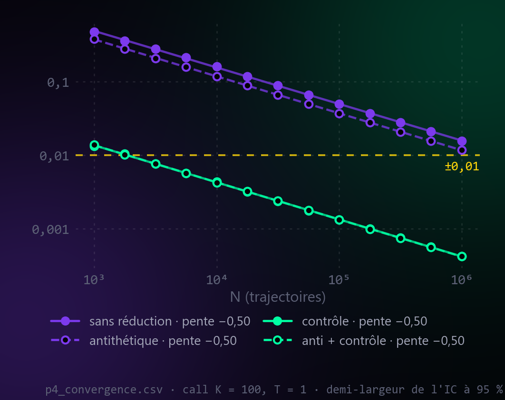
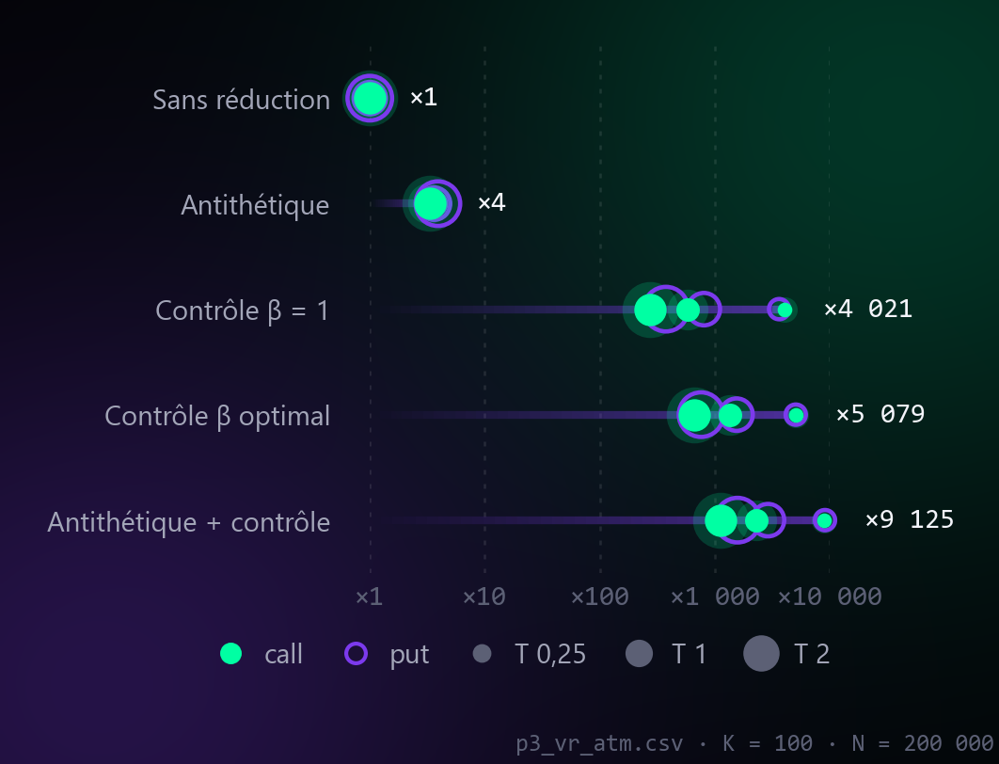
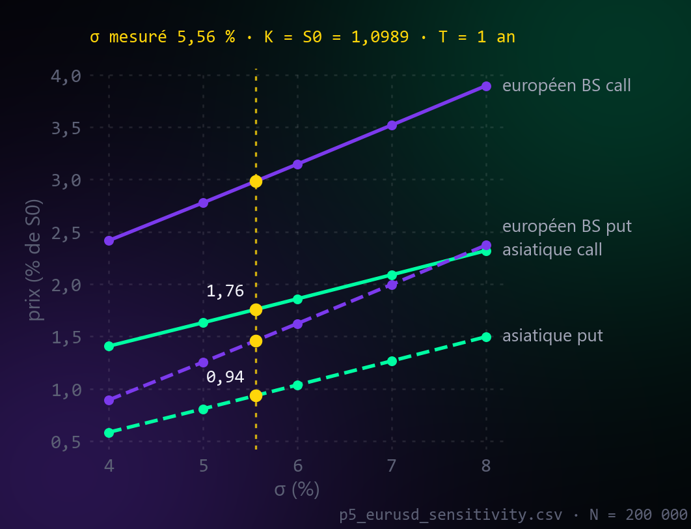
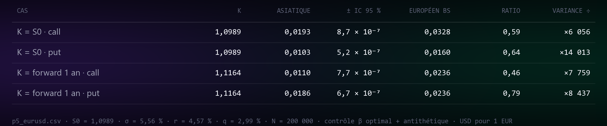

# Soutenance : l'option asiatique pricée par Monte-Carlo

Projet Pricing Monte-Carlo, énoncé 2. ECE Paris, ING4 Finance. Rendu le 22 novembre 2026.

Ce texte suit les quatre questions du sujet, puis présente le cas réel et ce que nous avons fait en
plus. Il tient en 8 à 10 minutes. Pour chaque partie : la figure à montrer, les phrases à dire, et le
chiffre à retenir. Les durées du tableau donnent 9 minutes 40 au total. La seconde moitié du
document prépare les questions.

Tous les chiffres viennent de nos fichiers de résultats. Le prix d'une option est toujours donné avec
sa marge d'erreur.

| Partie | Durée | Figure |
|---|---|---|
| Ouverture | 40 s | aucune |
| Q1, le pricer | 1 min 40 | figure 1 |
| Q2, la comparaison avec l'européenne | 1 min 15 | figure 2 |
| Q3, la réduction de variance | 1 min 50 | figure 5, tableau 1 |
| Q4, le gain de temps et de précision | 1 min 30 | figures 4 et 3 |
| Le cas réel EUR/USD | 1 min 40 | figure 6, tableau 2 |
| Ce que nous avons fait en plus | 45 s | aucune |
| Conclusion | 20 s | aucune |

---

## Ouverture (40 secondes)

**Ce qu'on dit.**

« Nous avons traité l'énoncé 2 : le prix d'une option asiatique par Monte-Carlo. Une option asiatique
paie sur la moyenne des cours relevés pendant la vie de l'option, et non sur le cours final. Nous
allons répondre aux quatre questions du sujet dans l'ordre : le pricer, la comparaison avec l'option
européenne, la réduction de variance, puis le gain de temps et de précision. Nous finirons par un cas
réel : la couverture de change d'un exportateur sur l'EUR/USD. Tout est codé en Python, et tous les
nombres aléatoires sont fabriqués par nos soins avec les méthodes du cours. »

---

## Q1 — Le pricer (1 minute 40)

**Ce qu'on montre.** La figure 1 : des trajectoires simulées, et à droite la répartition du cours
final et celle de la moyenne.

**Ce qu'on dit.**

« Notre pricer est une fonction, `price_asian`. Elle prend les paramètres généraux, S0, K, σ, r, T, q,
et le paramètre propre à l'asiatique : la fréquence d'observation du cours.

Elle travaille en trois temps. D'abord l'aléa. Nous partons d'un générateur congruentiel linéaire,
celui de Park-Miller, qui produit des nombres uniformes. Nous les transformons en nombres de loi
normale par la transformée inverse. Nous avons aussi codé Box-Muller, la méthode polaire et
l'acceptation-rejet, pour les comparer.

Ensuite les trajectoires. Sous Black-Scholes, le cours se simule sans erreur d'une date d'observation
à la suivante. Nous ne simulons donc que les dates dont nous avons besoin.

Enfin l'estimateur. Sur chaque trajectoire nous calculons la moyenne des cours, puis le gain de
l'option, que nous actualisons. Le prix est la moyenne de ces gains. Nous le rendons toujours avec
son écart-type et son intervalle de confiance à 95 %.

Sur la figure, une trajectoire est en blanc avec ses douze relevés mensuels. À droite, la moyenne est
moins dispersée que le cours final. C'est toute l'histoire de l'option asiatique.

Comment savons-nous que le pricer est juste ? Nous avons pricé l'option européenne avec le même
simulateur, et nous l'avons comparée à la formule de Black-Scholes sur 40 cas. La formule tombe
dans notre intervalle de confiance 40 fois sur 40. »

**Le chiffre à retenir.** Call asiatique à la monnaie, 1 an, observations mensuelles :
5,3242 ± 0,0009 (S0 = K = 100, σ = 20 %,
r = 3 %, q = 1 %, N = 200 000).

---

## Q2 — La comparaison avec l'option européenne (1 minute 15)

**Ce qu'on montre.** La figure 2 : le prix asiatique divisé par le prix européen, pour 5 strikes et
4 maturités. Plus le disque est gros, plus l'asiatique est en dessous.

**Ce qu'on dit.**

« Nous avons comparé les deux options sur une grille de cinq strikes et quatre maturités, pour le call
et pour le put. L'asiatique est presque toujours moins chère que l'européenne. À la monnaie, à un an,
le call asiatique vaut 5,3242 et le call européen 8,8273 : l'asiatique vaut
0,60 fois l'européenne.

Deux effets se lisent sur la figure. Le premier : l'écart grandit avec la maturité. Le ratio passe de
0,72 à trois mois à 0,58 à deux ans. Le second : l'écart est
beaucoup plus fort hors de la monnaie. Pour le call de strike 120, le ratio tombe à
0,20. Pour finir dans la monnaie, il ne suffit pas que le cours final dépasse le
strike : il faut que la moyenne le dépasse. À l'inverse, pour une option très dans la monnaie, les
deux prix sont proches : 0,92 au strike 80.

L'explication est la même partout : une moyenne varie moins qu'un cours final. Moins d'incertitude,
donc moins de valeur pour l'option. »

**Le chiffre à retenir.** À la monnaie, à 1 an, l'asiatique vaut 0,60 fois
l'européenne : 40 % de moins.

---

## Q3 — La réduction de variance (1 minute 50)

**Ce qu'on montre.** La figure 5 (chaque point est une trajectoire : gain géométrique en abscisse,
gain arithmétique en ordonnée), puis le tableau 1.

**Ce qu'on dit.**

« Le sujet demande une variable de contrôle : l'option sur moyenne géométrique. La moyenne
géométrique ressemble beaucoup à la moyenne arithmétique, et l'option sur moyenne géométrique
a un prix exact, par formule fermée. Sur chaque trajectoire, nous calculons donc les deux gains. Nous
savons de combien notre simulation se trompe sur l'option géométrique, puisque nous connaissons son
vrai prix. Nous utilisons cette erreur pour corriger le prix de l'option arithmétique.

La figure montre pourquoi cela marche si bien : les deux gains sont presque alignés. Leur corrélation
vaut 0,9996.

Le coefficient de correction, β, est celui du cours : la covariance divisée par la variance. Nous
l'estimons sur l'échantillon, ce qui fait mieux que le fixer à 1 : la variance est divisée par 1 384 au lieu de
630.

Le tableau résume cinq estimateurs sur le même cas. Tous donnent le même prix, à leur marge d'erreur
près. Mais la marge passe de 0,0350 sans réduction à 0,0009 avec le
contrôle, pour le même nombre de trajectoires.

Nous avons aussi testé les variables antithétiques du cours. Seules, elles divisent la variance par
un peu moins de deux. Ajoutées au contrôle, elles n'améliorent presque plus la variance. Nous ne
l'attendions pas. L'explication : une fois le contrôle appliqué, ce qui
reste du gain est presque le même pour une trajectoire et pour sa jumelle. En revanche la combinaison
demande deux fois moins de nombres aléatoires. Elle gagne donc du temps. »

**Le chiffre à retenir.** Avec la variable de contrôle géométrique, la variance est divisée par
1 384 (call, 1 an), et par 667 à 5 359 selon la
maturité.

---

## Q4 — Le gain de temps et de précision (1 minute 30)

**Ce qu'on montre.** La figure 4 (marge d'erreur en fonction du nombre de trajectoires), puis la
figure 3 (gain d'efficacité par méthode).

**Ce qu'on dit.**

« Nous avons mesuré la précision de deux façons. La première : la marge d'erreur en fonction du
nombre de trajectoires. En échelles logarithmiques, nous obtenons quatre droites parallèles, de pente
−0,50. C'est le théorème central limite : l'erreur diminue comme un sur racine de N,
quelle que soit la méthode. La réduction de variance ne change pas la pente. Elle abaisse la droite.

Concrètement, pour connaître le prix à plus ou moins 0,01, il faut 2 447 439
trajectoires sans réduction de variance. Avec le contrôle, il en faut 1 748.

La seconde façon tient compte du temps de calcul. Nous définissons l'efficacité comme la variance
multipliée par le temps. Le contrôle coûte un peu plus cher par trajectoire, mais il gagne environ un
facteur 1 400 en efficacité. Avec les antithétiques en plus, environ
2 400. Nous donnons ces gains à l'ordre de grandeur, parce qu'un temps de
calcul dépend de la machine : entre deux mesures, le même gain a varié de −15 % à
+37 %.

À temps égal, le résultat est le même. En 8 secondes, la marge d'erreur est de
0,0075 sans réduction. Avec le contrôle et les antithétiques, elle est environ
49 fois plus petite. »

**Le chiffre à retenir.** Pour une marge de ±0,01 : 2 447 439 trajectoires sans
réduction, 1 748 avec le contrôle. Environ 1 400 fois moins.

---

## Le cas réel : EUR/USD (1 minute 40)

**Ce qu'on montre.** La figure 6 (prix selon la volatilité), puis le tableau 2.

**Ce qu'on dit.**

« Après la validation sur un actif théorique, nous passons à un actif réel : le taux de change
EUR/USD. Nous l'avons choisi parce que l'option asiatique y a un usage concret. Un exportateur français encaisse des dollars chaque mois pendant un an. Ce qui compte pour
lui, c'est le taux de change moyen de l'année, pas celui d'un jour donné. Il se couvre donc avec un
call asiatique sur l'EUR/USD, avec douze observations mensuelles.

Pour le change, le modèle de Black-Scholes garde la même forme : le taux d'intérêt en dollars joue le
rôle de r, le taux en euros celui du dividende q. Nous avons calibré le modèle sur des données
officielles du 17 novembre 2026 : le fixing de la BCE pour le cours, 1,0989 ; un an de fixings pour
la volatilité, 5,56 % ; le Trésor américain pour le taux dollar, 4,57 % ; la courbe de
la BCE pour le taux euro, 2,99 %.

Le call asiatique à la monnaie vaut 0,0193 dollar par euro, soit 1,76 %
du cours. Le call européen équivalent vaut 2,98 %. Pour un million de dollars
encaissé chaque mois, la prime de l'option asiatique est d'environ 191 979 euros.

Nous ne connaissons pas la volatilité future. Nous donnons donc le prix pour des volatilités de
4 % à 8 % : le call asiatique coûte entre 1,41 % et
2,32 % du cours. »

**Le chiffre à retenir.** Call asiatique EUR/USD à la monnaie, 1 an : 0,0193 USD par
euro, soit 1,76 % du cours, contre 2,98 % pour l'européen.

---

## Ce que nous avons fait en plus (45 secondes)

**Ce qu'on montre.** Rien de nouveau : on reste sur le tableau 2.

**Ce qu'on dit.**

« Au-delà des quatre questions, nous avons fait cinq choses. Nous avons refait les exercices du cours
sur l'option asiatique et sur les variables antithétiques : la valeur de référence est dans notre
intervalle de confiance à 99 % dans 56 cas sur 56. Nous avons comparé les
cinq méthodes de génération de normales à l'intérieur du pricer : elles donnent le même prix. Nous
avons mesuré l'effet de la fréquence d'observation et calculé les sensibilités du prix. Nous avons
cherché le biais que peut créer l'estimation de β, sans le détecter. Enfin, tout est reproductible :
même graine, même prix, et plusieurs centaines de tests automatiques.

En codant les formules, nous avons aussi relevé six coquilles dans les slides. Nous les tenons à
votre disposition. »

**Le chiffre à retenir.** 56 sur 56 : nos intervalles de confiance contiennent
la valeur de référence dans tous les cas des exercices du cours.

---

## Conclusion (20 secondes)

**Ce qu'on dit.**

« Pour résumer : l'option asiatique vaut environ 0,60 fois l'européenne à la monnaie.
La variable de contrôle géométrique divise la variance par plus de mille. Et il faut environ
1 400 fois moins de trajectoires pour la même précision. Nous vous remercions et
nous sommes prêts pour vos questions. »

---

## Questions probables du professeur

Les réponses tiennent en quelques phrases. Les chiffres sont les mêmes que dans le rapport.

### 1. Pourquoi ne pas avoir utilisé `numpy.random` ?

C'est la consigne du cours : les normales doivent venir d'un générateur congruentiel linéaire et
d'une méthode du cours. Nous l'avons appliquée strictement. Un test automatique refuse toute
utilisation de `numpy.random`, de `random` ou de SciPy dans le code du pricer. NumPy ne sert qu'au
calcul vectoriel. SciPy ne sert que dans les tests, comme référence indépendante pour vérifier nos
propres fonctions.

### 2. Pourquoi la transformée inverse par défaut, alors que Box-Muller est plus rapide ?

Box-Muller est en effet la plus rapide : 0,037 seconde pour 1 000 000 normales, contre
0,256 pour notre transformée inverse. Nous gardons la transformée inverse pour deux
raisons. Elle consomme une uniforme par normale, ce qui simplifie le suivi du flux aléatoire. Et elle
est monotone : la variable antithétique du cours, U remplacé par 1 − U, s'applique alors exactement.
Le choix ne change pas le prix : les cinq méthodes sont à moins de 1,07 écart-type de la
référence.

### 3. Comment savez-vous que vos nombres aléatoires sont bons ?

Nous testons chaque méthode sur 1 000 000 tirages : moyenne, variance, asymétrie, aplatissement,
autocorrélation et test de Kolmogorov-Smirnov. La plus petite p-value vaut 0,60. Notre
générateur reproduit au bit près les couples de constantes cités dans le cours. Et la preuve la plus
parlante est en aval : avec ces nombres, notre prix européen retombe sur la formule de Black-Scholes
dans les 40 cas testés.

### 4. Pourquoi la moyenne géométrique comme variable de contrôle ?

Pour deux raisons. Elle a un prix exact : un produit de variables log-normales est log-normal, donc
la moyenne géométrique est log-normale et l'option se price par une formule de type Black-Scholes. Et
elle est très corrélée à la moyenne arithmétique : 0,9996 dans notre cas central.
Une bonne variable de contrôle doit avoir ces deux qualités, une espérance connue et une forte
corrélation.

### 5. Pourquoi estimer β plutôt que prendre β = 1 ?

Le cours donne le β optimal : Cov(X, Y)/Var(X). Nous l'avons mesuré entre 0,9649 et
1,0482 selon la maturité et le type d'option. Il est proche de 1, mais l'écart compte : avec
β = 1 la variance est divisée par 630, avec β optimal par
1 384. Avec le β optimal estimé sur l'échantillon, la variance est divisée par
1/(1 − ρ²), où ρ est la corrélation.

### 6. Estimer β sur le même échantillon ne biaise-t-il pas le prix ? Que vaut ce biais ?

En théorie oui, d'un terme en 1/N (cette remarque dépasse le cours). Nous avons cherché ce biais en
répétant 2 000 fois un calcul à 1 000 trajectoires, sur des tirages indépendants. La
moyenne des prix est à +1,00 écart-type de la référence : rien de détectable. Notre
intervalle de confiance à 95 % contient la référence dans 94,8 % des répétitions. Par
honnêteté : une première série de 500 répétitions donnait −2,51
écart-type pour une variante sans biais par construction. Nous avons refait la mesure sur
2 000 répétitions, elle donne −1,45 : c'était une fluctuation.

### 7. Pourquoi « antithétique + contrôle » n'améliore pas toujours la variance ?

L'antithétique marche quand le gain d'une trajectoire et celui de sa jumelle sont corrélés
négativement. C'est le cas pour le gain brut. Mais une fois le contrôle appliqué, il reste à peu près
la différence entre moyenne arithmétique et moyenne géométrique. Cette différence mesure la
dispersion de la trajectoire, qui est presque la même pour Z et pour −Z. La corrélation devient
positive. À nombre de trajectoires égal, la combinaison fait donc jeu égal avec le contrôle seul à la
monnaie (1 398 contre 1 384), et moins bien dans la
monnaie. Son intérêt est ailleurs : deux fois moins de normales à tirer, donc un calcul plus rapide.

### 8. Pourquoi l'asiatique est-elle moins chère, et surtout hors de la monnaie ?

Parce que la moyenne varie moins que le cours final. La valeur d'une option vient de l'incertitude :
moins d'incertitude, moins de valeur. Hors de la monnaie, l'effet est amplifié. Pour que l'option
paie, il faut que la moyenne franchisse le strike, ce qui demande que le cours reste haut longtemps.
Un pic en fin de période ne suffit pas. Nos ratios : 0,92 dans la monnaie,
0,60 à la monnaie, 0,20 hors de la monnaie (call, 1 an).

### 9. L'asiatique peut-elle valoir plus que l'européenne ?

Oui, dans un cas de notre grille : le put de strike 120 à trois mois, avec un ratio de
1,0009. C'est un put très dans la monnaie, et r est supérieur à q : le cours monte
en espérance, donc la moyenne est en espérance sous le cours final. Un put sur la moyenne vaut alors
un peu plus qu'un put sur le cours final. L'écart est petit mais significatif : l'intervalle de
confiance du ratio est [1,0008 ; 1,0009].

### 10. Pourquoi le call EUR/USD vaut-il plus que le put, au même strike ?

Parce que le taux dollar (4,57 %) est supérieur au taux euro (2,99 %). Le cours à terme de
l'euro, 1,1164, est donc au-dessus du cours du jour, 1,0989. Un call de strike égal au cours du
jour est déjà dans la monnaie par rapport au cours à terme : il vaut 0,0193, contre
0,0103 pour le put. Au strike égal au cours à terme, le call et le put européens ont le
même prix, 0,0236.

### 11. Comment choisissez-vous N pour une marge d'erreur donnée ?

Avec la formule N = (z·σ̂/ε)². σ̂ est l'écart-type du gain par trajectoire, mesuré sur un premier
échantillon de 100 000 trajectoires. ε est la marge voulue, et z vaut 1,959964 à 95 %. Pour
ε = 0,01, cela donne 2 447 439 trajectoires sans réduction et 1 748 avec
le contrôle. Diviser la marge par dix multiplie N par cent.

### 12. Pourquoi la pente vaut-elle −0,5 sur votre graphique de convergence ?

C'est le théorème central limite. L'écart-type de la moyenne de N tirages vaut σ/√N. La demi-largeur
de l'intervalle de confiance vaut donc z·σ/√N. En prenant le logarithme : une constante, moins un
demi du logarithme de N. Nous avons mesuré la pente sur 13 valeurs de N : entre
−0,4963 et −0,5049 selon l'estimateur. La réduction de variance diminue σ, donc la
constante. Elle ne change pas la pente.

### 13. Comment mesurez-vous le gain de temps ? Est-il fiable ?

Nous mesurons le temps médian de trois exécutions et nous calculons l'efficacité, variance × temps.
Le ratio de variance est exact et reproductible. Le temps ne l'est pas : il dépend de la machine et
de sa charge. Nous avons fait deux mesures. D'une mesure à l'autre, les gains d'efficacité ont varié
de −15 % à +37 %. Pour le contrôle seul, nous avons obtenu 1 454 puis
1 350. Nous annonçons donc un ordre de grandeur, environ
1 400, et pas un chiffre à l'unité.

### 14. Vos résultats sont-ils reproductibles ?

Oui. Tout part d'une graine unique, 20261117. La même graine redonne le même prix, au bit près : un
test le vérifie. Les versions des bibliothèques sont fixées. Les données de marché sont enregistrées
telles que nous les avons reçues, avec leur date et leur adresse. Les figures et le classeur Excel se
régénèrent à l'identique à partir des fichiers de résultats. Et aucun chiffre du rapport n'est tapé à
la main : ils sont recopiés des fichiers de résultats par un script.

### 15. Quelles sont les limites de Black-Scholes pour le change ?

Le modèle suppose une volatilité constante, des taux constants et pas de sauts. Sur le marché des
changes, la volatilité dépend du strike et de la maturité, et elle change dans le temps. Nous
utilisons une volatilité historique, 5,56 %, faute de volatilité implicite accessible
gratuitement. Notre prix est donc un prix de modèle, pas une cotation. C'est pourquoi nous le donnons
aussi pour des volatilités de 4 % à 8 %.

### 16. D'où viennent vos taux, et avec quelles conventions ?

Le taux dollar est le rendement à un an publié par le Trésor américain, 4,62 %. Il est publié
en base semestrielle : nous le convertissons en taux continu par r = 2·ln(1 + y/2), ce qui donne
4,57 %. Le taux euro est le taux à un an de la courbe de la BCE pour les États notés AAA. La
BCE le publie déjà en taux continu : nous le prenons tel quel, 2,99 %. Le cours est le fixing
de référence de la BCE. Nous avons recoupé cette série avec une seconde source : l'écart absolu moyen
est de 0,0022.

### 17. Le générateur de Park-Miller est-il suffisant ?

Sa période est d'environ deux milliards de valeurs. Notre plus long calcul en consomme
312 000 000 : nous restons en dessous, et nous avons vérifié que le flux ne repasse pas par son
point de départ. Il y a un piège : deux graines voisines donnent des suites qui se recouvrent. Quand
nous avons besoin de répétitions indépendantes, nous ne changeons donc pas de graine. Nous découpons
un seul flux bout à bout, grâce à une formule de saut qui donne directement la n-ième valeur.

### 18. Quelles coquilles avez-vous relevées dans le cours ?

Six, trouvées en codant les formules telles qu'elles sont imprimées.

1. Slide 9 : la condition de période complète du générateur mixte est écrite « c = 0 » ; il faut
   c ≠ 0.
2. Slide 23, méthode polaire : « V = −2U − 1 » ; il faut V = 2U − 1. Telle quelle, la méthode
   n'accepte aucun candidat.
3. Slide 24, Hastings : le dénominateur doit commencer par 1 + d1·t.
4. Slide 24, Hastings : t vaut √(−2 ln p). Avec cette forme, nous retrouvons la précision annoncée.
5. Slide 76 : T̄ est la moyenne des dates d'observation, pas la moyenne des cours.
6. Slide 76 : dans la variance de la moyenne géométrique, les indices i et j sont mélangés. Avec un
   seul indice, la formule est égale à la nôtre.

### 19. Qu'est-ce qui, dans votre travail, dépasse le cours ?

Peu de choses, et elles sont signalées comme telles dans le code. La formule de saut du générateur.
L'exemple d'acceptation-rejet pour la loi normale, que le cours ne donne pas. L'estimation de β sur
un échantillon séparé, qui nous a servi à étudier le biais. La limite de la moyenne géométrique quand
les observations deviennent continues. Tout le reste suit les notations et les formules du cours.

### 20. Sur l'exercice du slide 78, vos prix antithétiques sont au-dessus de la valeur exacte. Pourquoi ?

Avec 100 000 trajectoires, nos prix antithétiques sont entre +1,68 et
+1,83 écart-type au-dessus de la formule, pour le call comme pour le put. La valeur
exacte reste dans notre intervalle de confiance à 99 %. La cause est dans le tirage : les 50 000
premières normales de notre graine ont une variance de 1,0105 au lieu de 1. L'antithétique
annule les écarts sur les moments impairs, pas un écart sur la variance, et une variance un peu forte
pousse le call et le put vers le haut. Nous avons gardé cette graine : en changer pour mieux tomber
aurait été de l'ajustement.
